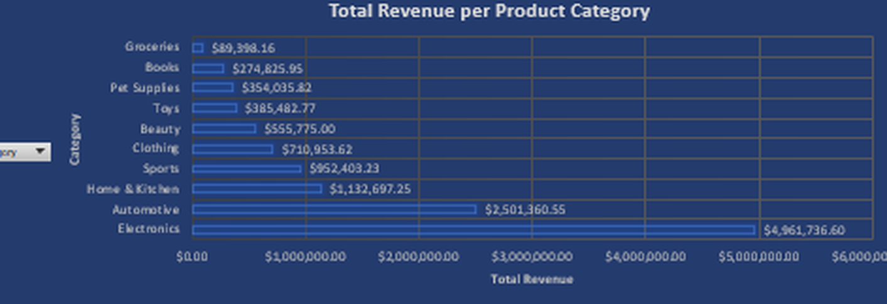
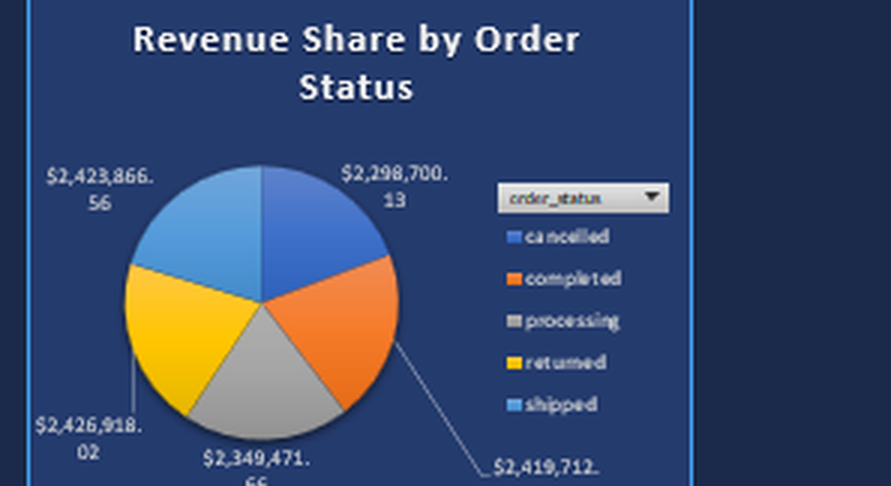
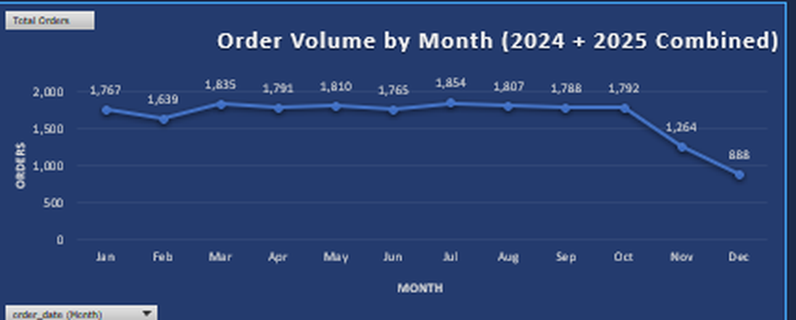

# E-Commerce & Delivery Analytics

This is an Excel dashboard I built for my Data Modeling course at BINUS
University. My teammate and I worked with an online store's data covering 2024
and 2025, and the goal was to turn six raw tables into one interactive dashboard
that shows where the revenue comes from and how orders end up.



## What I found

**Two categories carry the business.** Electronics brings in $4.96 million (41.6%
of revenue) and Automotive $2.50 million (21.0%). Together they make up almost
two thirds of total revenue, while the bottom four categories (Toys, Pet
Supplies, Books, Groceries) add up to less than 10%.

**Only about 40% of revenue comes from orders that clearly went through.** The
revenue is split almost evenly across the five order statuses. Completed and
shipped orders account for 40.6%, while cancelled (19.3%) and returned (20.4%)
orders together account for 39.6%. If this were a real store, a return and
cancellation rate that high would be the first thing I would want to look into.

**Order volume is stable.** The store handles roughly 850 to 950 orders a month
in both years, with no strong seasonal peak. The average order value is about
$596.



## Dataset

The data is a synthetic e-commerce dataset made of six CSV files:

| Table | Rows |
|---|---|
| users | 10,000 |
| products | 2,000 |
| orders | 20,000 |
| order_items | 43,525 |
| reviews | 15,000 |
| events | 80,000 |

Orders run from January 2024 to mid-November 2025.

## How we built it

This was a two-person project. My teammate, Marvel Valentino Junior, handled the
data cleaning. I built the analysis and the dashboard.

- **Data cleaning:** text and date formulas to standardise names, extract
  usernames and sign-up years, and add helper columns such as price category and
  order size.
- **Named ranges and lookups:** named ranges for category lists, price thresholds,
  and discount rates, plus VLOOKUP and XLOOKUP to connect the tables.
- **What-if analysis:** a scenario model that estimates annual revenue, gross
  profit, and net profit from monthly orders, average order value, operating
  margin, and tax rate.
- **Power Pivot:** a data model that links the tables, with DAX measures for
  Total Revenue and Average Order Value.
- **Dashboard:** KPI cards built with CUBEVALUE, PivotCharts, and slicers for
  category, month, and order status.



## Limitations

- The data is synthetic, so the patterns show how I analysed it rather than how a
  real store behaves.
- Total Revenue on the dashboard includes cancelled and returned orders. I kept it
  that way to match the assignment, so read it as gross order value rather than
  money the store actually kept.
- The monthly order chart combines 2024 and 2025 by month name. Because the data
  stops in mid-November 2025, November and December look lower than the other
  months. That drop comes from missing data, not a real slowdown.
- The title says "Delivery", but the dataset has no shipping time or cost, so
  delivery is only covered through order status.

## Repository structure

```
ecommerce-delivery-analytics/
├── workbook/   # the full Excel workbook (data, Power Pivot model, dashboard)
└── assets/     # dashboard screenshots
```

To explore it, download `workbook/ecommerce_delivery_analytics.xlsx` (about
28 MB) and open it in Excel for Windows. The slicers and Power Pivot model need
the desktop version of Excel.

## Tools

Microsoft Excel, Power Query, Power Pivot, and DAX.

## About me

Marco Alexander, Information Systems student at BINUS University with a focus on
Business Intelligence.
[linkedin.com/in/marcolex](https://linkedin.com/in/marcolex)
